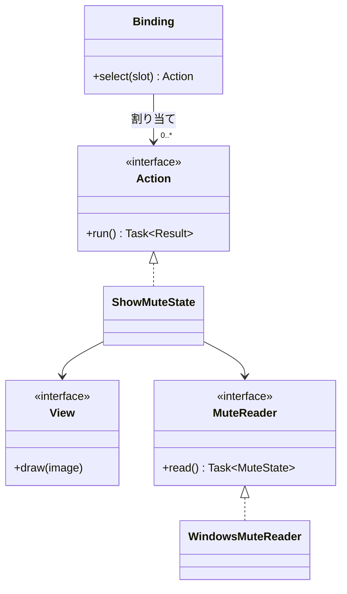
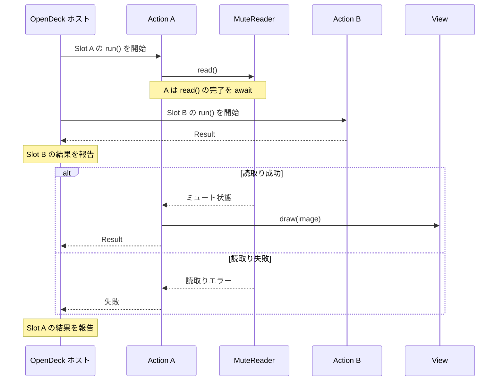

# 拡張ホストの基本設計案

[拡張利用の要件案](../requirements/extensions.md)の導入・稼働管理を具体化する、基盤の利用側の設計案。
基盤は抽象化した入力データとAPI・インターフェースを提供し、操作の具体処理は拡張側が所有する。
ホストの方式は基盤の入力契約と別に検討し、押下・回転のAPI提供をホストの完成待ちにはしない。
現行コードに外部拡張ホストを導入したことを示す文書ではない。
共通の依存方向、Command・Observer・Abstract Factoryと純粋計算の分離は[基盤の基本設計](../design.md)に従う。
利用要求のうち確認済みの事項は[要件案](../requirements/extensions.md)に置く。
以下の契約と初回方式は提案であり、方式まで承認済み・実装済みとは扱わない。
具体方式の候補、実装順序、TDDのテストリストは[設計・実装プラン](../plans/extension-host.md)で管理する。

## 現在の到達点

現行の基盤はActionの生成処理を登録し、Bindingとdrainで実行できる。
Buttonの開始・継続・終了、Read・Input・Subjectの限定した能力も利用できる。
[利用ガイド](../extensions.md)は、それらをアプリ側のコードで組み立てる手順を説明している。

標準CLIはlaunchの生成処理を固定しており、外部拡張を指定して読み込む入口はない。
拡張ごとの開始・終了、入力の配送先の登録解除や開始失敗時の解放を管理するホストもない。
単発Actionを呼べることと、入力を継続して利用する拡張を運用できることは、別の到達点として扱う。

## 最初のユースケース（提案）

### Given

利用者が信頼する外部拡張と、一つのパッケージが提供する複数の単発操作を選んでいる。
各操作には個別の設定があり、機器から独立した入力への別々の割り当てがある。
同じ操作を異なる設定で使う場合も、設定と状態を混同しない。

### When

利用者がホストを開始し、割り当てた入力を発生させ、最後にホストを終了する。

### Then

基盤や標準の組み立てコードを編集せず、選んだ拡張の操作が実行される。
開始準備が済んだ拡張だけを利用し、実行結果を対応する入力と区別できる。
終了後に新しい実行を始めず、所有した登録と資源を解放する。

### Failure

未導入、非対応、提供操作の衝突、設定不備、読込み・開始・実行・終了の失敗を区別する。
開始途中の失敗でも、取得済みの資源と登録を残したまま利用可能と表示しない。
入力元の利用不能は正常な入力や未割り当てへ置き換えない。

最初の到達点はこの一連の運用に限定する。
継続入力の複数拡張への配送、表示、既存配布形式の互換実行まで完成したとは扱わない。

## 最小の協調と契約（提案）

```text
組み立て側 -> 拡張の読込み境界 -> 未開始の稼働と操作の生成能力
組み立て側 -> 既存の設定処理 -> 構成済みActionとBinding
組み立て側 -> 稼働の開始 -> 入力元の開始
入力の配送 -> Bindingによる選択 -> Actionによる実行
組み立て側 -> 配送の停止と入力元の解放 -> 稼働の終了
```

これは実行時の協調であり、具象実装へのコードの依存方向を示すものではない。
このホスト案で追加する契約の候補は、次の二つの境界に絞る。具体的なクラス名や署名はまだ固定しない。
基盤の入力APIの検討範囲を、この二つの境界に限定するものではない。

### 拡張の読込み境界

- 選択済みの拡張を受け取り、同じ所有元に属する未開始の稼働と操作の生成能力を提供する。
- 読込み先の表現、実装の選択、外部形式の検証と適合は、この境界へ閉じる。
- 提供操作は既存の生成処理の登録へ接続する。共通の設定処理に拡張別の分岐を追加しない。
- 読込みと構成は操作の実行ではない。対象資源の取得は稼働の開始へ分ける。
- 非対応や読込み失敗時は提供済みと扱わず、すでに取得したものは読込み側で後始末する。

### 拡張の稼働

- 開始は、構成済みActionを利用できる状態へ移し、開始失敗と成功を区別する。
- 終了は、稼働が所有する資源を解放する。未開始・開始途中の失敗からも後始末できる。
- 組み立て側は稼働を受け取った直後から終了の責任を持ち、開始前の後続処理の失敗も扱う。
- 内部の開始状態を照会してホストが解放手順を代行せず、稼働へ終了を依頼する。
- 終了失敗を握り潰さず、他の所有物の解放も試みる。自動再試行は契約に含めない。

操作の構成と実行には、既存の生成処理とActionを使う。
操作の登録だけを包む汎用Registryや、全能力を渡すContextは追加しない。
初回の拡張は入力元を開かず、Bindingや入力の書込み能力を所有しない。

### Creation Boundary

拡張の選択・生成は、読込み境界と組み立て側に限定する。
Actionや配送側は、外部の識別表現や具象実装を選択しない。
関連する稼働と操作の生成能力は、一つの生成境界から整合した組として渡す。
現在必要な生成だけを設け、将来の実行形式のためにAbstract Factoryの階層を先行導入しない。
機器側の既存Abstract Factoryの責務は変更しない。

### Contract-only Walkthrough

正常系:

1. 選択した拡張を読み込み、受け取った稼働の終了責任を直ちに登録する。
2. 操作の生成能力を接続し、設定からActionとBindingを構成する。この時点で操作しない。
3. 選択した稼働をすべて開始する。途中失敗なら入力元を開始せず、後始末へ進む。
4. 通知登録を試みる前から解除を所有し、入力元を接続して初回配送を予約する。
5. 配送側は既存の入力・割り当て・実行契約を使い、停止の順序を守る。
6. 停止を配送境界で受理した後は、新しい入力を取得せず、引渡し済みの処理の収束を待つ。
7. 初回は拡張へ入力元を渡さないため、通知解除・入力元の解放後に操作への所有参照を外す。
8. 稼働の終了を取得と逆順に依頼する。途中の解放失敗でも残りの解放を試みる。

失敗系:

- 読込み・設定不備・開始失敗では配送を開始せず、取得済みの稼働を終了する。
- 入力元の構成・通知登録・接続の失敗も、開始済みの稼働の終了へつなげる。
- Actionが返す失敗・結果不明は、その実行の結果であり、拡張の読込み失敗と混ぜない。
- Actionの例外や入力取得失敗では初回ホスト全体を停止し、原因を残して後始末する。
- 終了も失敗した場合は、元の失敗と解放の失敗を両方残す。
- 終了後の遅れた入力通知で、終了した拡張を再実行しない。

## 初回の所有・失敗境界（提案）

ホストは、自分が取得した稼働、操作への参照、通知登録、入力元の解放を所有する。
拡張は自分が開始時に取得する資源を所有し、その解放手順を実装する。
生成処理は設定検証と構成だけを行い、資源取得や対象状態の照会を行わない。
生成途中で資源を取得してから解放口を返さず失敗する設計にしない。

既存の設定では、異なる名前の操作定義から別々のActionを構成する。
同じ名前の操作を複数のSlotへ割り当てた場合は、既存どおり同じActionを共有する。
別々の状態が必要なら別定義を使い、この意味をホスト導入で黙って変更しない。
初回は配置ごとの新しい識別体系や、稼働中の設定変更を追加しない。

### 複数機能の提供と割り当ての適合

[パッケージと機能の割り当て](../requirements/extensions.md#パッケージと機能の割り当て)を満たすため、
一つの読込み結果から複数の操作の生成能力を接続できるようにする。
提供する操作の種類、設定から構成した操作定義、Slotへの割り当て、拡張の稼働を区別する。
操作の数や割り当ての数だけ、同じパッケージの稼働を開始する構成にしない。
パッケージ間の操作名の衝突は登録境界で拒否し、設定・状態の共有は前述の所有規則に従う。

接続に必要な入力能力と操作の契約は、選択した操作ごとに確認する。
パッケージ名や物理部品名から、提供する能力や操作の具体処理を推定しない。
割り当ての構成時に非対応を拒否し、設定画面で選択肢を隠すだけにはしない。
操作を試しに実行したり、対象の現在状態を取得したりして、構成時の適合を判定しない。
この判定をSDKアダプタや機器用Factoryへ持ち込まない。

現行のActionは単発実行、Buttonは入力の保持状態を扱う。
対象のON/OFF指定・反転・照会・同期は操作の実装側の責務であり、押下・回転への割り当ての共通条件にしない。
呼び出し側は実装内部を調べず、契約された操作を呼ぶ。
押下・回転の独立した能力と、同じノブでも別の操作を割り当てる方針は[基盤の基本設計](../design.md#責務と契約)に従う。
回転データの受渡しなど未実装の差分は[入力APIの対応計画](../plans/input-api.md)で扱う。

### 現行の直列実行とその制約

現行の `drain()` は Action を直列に実行する。
Actionが返す失敗・結果不明の後も、既存どおり次の入力を処理し、自動再実行しない。
一方、例外による異常終了を黙って別の拡張への配送継続へ変えない。
同期呼出しの停滞は他の操作と終了を遅らせ得る。強制停止や障害分離は保証しない。

APIで渡す能力を絞ることは、信頼できないコードに対する安全境界ではない。
読込み時の任意の副作用や、拡張が外部へ残した参照を、ホストが完全に巻き戻すとは保証しない。
信頼できる拡張の協調的な終了を前提とし、満たさない拡張を安全に隔離したとは扱わない。

### Action の完了を待たずに次の入力を扱う案

[#36](https://github.com/TakumiOkayasu/OpenDeck/issues/36) では、ある Action が非同期処理の完了を待つ間も、独立した Action を開始できることを前提とする。
現行の [drain()](../../native/src/runtime.cpp) は `Binding::select()` で Action を選び、`run()` の結果を報告してから次の入力を取る。

例として、ボタン A は PC のミュート状態を読み、ボタン B は別の操作を実行する。A が OS の応答を待つ間も B を操作したい。
ホストは Action を開始し、呼び出しごとに元の Slot と完了を追跡する。完了した操作から、その Slot に結果を一度だけ報告する。
拡張側は状態を読んでから描画するなど、順序が必要な箇所で `await` する。

#### クラス図

`ShowMuteState` は拡張の実装例。必要な `MuteReader` と `View` はコンストラクタで受け取る。
Windows API のハンドルや戻り値は Windows 側の実装で解釈する。拡張が受け取るのはミュート状態か読取りエラー。
図中の `Task<T>` は結果を待てることを表す仮の型名。



#### シーケンス図

A が待機中に B の入力があり、B が先に完了する例。



#### ホストが防ぐ競合とデッドロック

| 場面 | ホストの動作案 |
| --- | --- |
| 同じ Action を続けて呼ぶ | 同じインスタンスへの入力は受付順に実行する。二つの Slot が同じインスタンスを参照していても、先の呼び出しが終わるまで次を開始しない。他のインスタンスは開始できる。 |
| 二つの拡張が同じリソースを占有する | 割り当て時に、必要な画面領域・ボタン・LED の組み合わせを一括で確保する。全画面とサブ画面のように一部でも重なる場合は、新しい割り当て全体を競合として返す。一部を確保して残りが空くのを待つ経路は作らない。 |
| `await` 中に画面が別の拡張へ割り当てられる | `unbind` で元の View を失効させる。再開した Action の描画は失効として返す。描画の受付と失効は表示先ごとに順序付け、受付済みの旧描画が新しい所有者の描画を追い越すことも防ぐ。 |

ホストがロックするのは、割り当てや実行状態を確認・更新する間だけとする。
Action の呼び出し、`await`、結果通知、SDK 呼び出しの前にロックを解放する。通知先がホストの API を呼び返しても、元の呼び出しが持つロックの解放待ちにならない。
同じ Action の実行順はホストが管理する。拡張にロックを渡したり、実行中の Action が自分の後続呼び出しの完了を待てる API を設けたりしない。

#### Python での検証

[AsyncHost](../../src/opendeck/host.py) と[実行例](../../examples/async_actions.py)で試せる。入力元は既存の Product を使う。
ホストを組み立てる側が `TaskGroup` と Action ごとの受付上限 `pending_limit` を渡す。上限は実行中の1件を含み、超過した入力は Slot とともに失敗を報告する。
拡張は `async def run()` から `Result` を返す。通常の失敗は後続の操作を止めない。予期しない例外は TaskGroup の呼び出し元へ伝わり、グループは停止する。

`Resource.parts` には占有する最小単位を指定する。全画面の parts にサブ画面と同じ ID を含めると、割り当て時に競合を検出できる。
組み立て側は機種に合わせて重複を宣言し、拡張には割り当てから取得した View を渡す。
初回は表示先を排他的に割り当てる。複数拡張の画像を合成する場合はレイヤー順と再描画の契約が必要になるため、今回の対象から外す。全画面は必要な領域すべてを一括で要求する。
ページを切り替えるときは、ホストが旧ページの割り当てをすべて `unbind()` してから次のページを割り当てる。拡張終了時も同じ手順で View を失効させる。実行例ではページ内の割り当てを `ExitStack` に登録し、描画や初期化が途中で失敗しても接続を閉じる前に解放する。
描画と割り当ての更新は同じイベントループで行う。同期の `draw()` が戻る前に描画先から同じ割り当てを解除しようとした場合はエラーを返す。
SDK 内部で転送をキューに入れる機器の表示順序は実機で確認する。

#### 受入テスト

fake で待機と再開のタイミングを指定し、次の順序を再現する。

1. A の読取りを保留して A を再度押し、続けて B を押す。B が完了し、二度目の A は一度目の完了後に開始する。各結果は元の Slot に一度だけ届く。
2. A がサブ画面を使用中に、B が全画面と未使用の LED を要求する。B に競合が返り、A はサブ画面を使い続けられる。第三の拡張はその LED を取得できる。
3. A の読取りを保留し、`unbind` 後に同じ領域を B に渡す。B の描画後に A を再開しても B の表示が残る。A の描画が失効直前に受付済みだった順序も確認する。
4. 結果通知のコールバックから同じ割り当ての解除を呼ぶ。解除と通知の両方が戻り、その後も B を操作できる。
5. A の読取りを失敗させる。表示を維持して失敗を一度だけ報告し、次の A を開始できる。

#### 未決定事項

入力キューが満杯になった場合の押下・解放の扱い、停止時に実行中の Action を待つ期限、制御を返さない拡張を別プロセスに隔離するかは #36 で検討する。
画面・LED のどの組み合わせが実機で独立して使えるかは、機種ごとに確認する。上記の競合判定は OpenDeck が管理するリソースを対象とし、拡張内部のロックや外部アプリとの排他は各実装が扱う。

### 停止の順序と通知登録（提案）

停止時は、新しい入力の受付と、すでに受け付けた操作の完了を別々に扱う。
停止要求の受理と次の取得の開始を、ホストの同じ制御境界で順序付ける。
取得前に停止を受理した場合は取り出さず、取得済みなら各呼び出しの結果を追跡する。
引渡し済みの入力を黙って捨てず、正常終了を強制的なAction中断と同一視しない。
停止要求の到着、配送停止の確定、終了完了を区別する。

初回はCtrl+Cも協調的な停止要求へ適合する案とする。
開始・実行・終了の呼出しが戻らなければ、通常停止の完了も保証しない。
実際の割込みがそれらの呼出しを中断した場合は、通常停止とは別の異常経路として原因を残す。
実行結果が得られなかった操作を成功にせず、自動再実行しない。
割込み中の後始末と、解放中にさらに失敗した場合の記録も検証する。

通知登録は、正常に戻る前に登録だけを変更して失敗する場合がある。
初回ホストは専用Observerの登録試行前から解除を所有する。
未登録でも安全に解除できることを利用するSubjectの成立条件に含め、実装時に確認する。
登録・解除の失敗で、入力元や他の稼働の解放まで飛ばさない。

## このホスト案でモデル化しない差異

- 自作か配布物かという入手元による契約の違い。
- 対応する実行形式の数に合わせた継承階層や、汎用の通信・永続化機構。
- 継続入力のための新しい配送先契約、ノブ、表示、設定画面の能力。
- 同じActionの利用とは別の、外部形式固有の操作配置や識別子。

継続入力の共有は、単発操作とは別のユースケースとして次に設計する。
その際は既存のButton・Read・Input・Subjectを再利用し、単一の取得側を保つ。
各拡張へ同じ消費型Inputを直接渡す案は採用しない。
記録の配送先契約、順序、容量、失敗・停滞、終了の条件を確定するまで、配送対応済みとしない。

## 基盤とホストの境界

ホストは基盤の公開契約を利用する側に置く。
個別操作の規則は拡張が所有し、ホストは拡張の導入、稼働期間と、必要な能力との接続を管理する。
機器用Factoryや入力認識へ、拡張の探索・起動・操作選択を集めない。

ホストの共通処理は、実行形式に適合する境界を利用する。
その境界が、必要な実行環境の開始・終了、外部形式との変換と接続を引き受ける。
拡張の入手元は導入情報として管理し、実行形式を選ぶ条件とは分ける。
外部契約と実行条件が一致する拡張は、自作・配布元の違いによらず同じ適合経路を利用できる。
同じ言語や実行ファイル形式であることだけで、互換性を判断しない。

既存の公開契約を再利用し、外部形式の識別子や通知を基盤の型へ直接持ち込まない。
共通処理は必要な契約だけを参照し、具体的な実行環境を直接操作しない。
実行形式が対応しない能力を要求する場合は、その不足を示し、対応済みとして開始しない。

## 分ける責務

| 責務 | 所有する内容 | 持ち込まない内容 |
| --- | --- | --- |
| 導入と識別 | 利用者が選んだ拡張、導入元、同一性と対応条件 | 操作の実行や機器の接続 |
| 実行形式への適合 | 外部形式の読込み、実行環境への接続、表現の変換 | キーコンフィグや操作固有の意味 |
| ライフサイクルの制御 | 開始、稼働、終了、失敗と所有資源の解放順 | 個別操作の判定規則 |
| 操作の構成 | 拡張の提供する生成処理と、割り当てごとの構成 | 外部拡張の探索や入力の取得 |
| 入力の配送 | 利用する入力と配送先の対応、稼働中の受け渡し | 時間や組み合わせによる操作の解釈 |
| 設定の保持と供給 | 拡張全体と割り当てごとの設定の区別と対応 | 設定値が持つ操作固有の意味 |
| 表示への接続 | 拡張が作る内容と、対応する表示能力への接続 | 内容の生成と機器固有の描画方法 |

各行を一つのクラスへ固定しない。独立した能力は分け、関連する状態の所有と整合条件を定めてから具体化する。
起動時に提供機能を登録する処理と、入力に応じて操作する処理を分ける。
表示先など未実装の能力は、必要性と契約を確定してから追加する。

## 整合条件

- 拡張そのものの稼働単位と、入力へ割り当てた操作の単位を区別する。設定・状態・表示先を割り当て間で混同しない。
- 導入情報と設定の検証を、読み込み・起動・状態保持・通知から分ける。取得済みの不変値を検証する計算は純粋にする。
- 開始準備が完了するまで入力の配送を有効にしない。開始失敗時は途中までの登録と所有資源を解放する。
- 終了時は新しい配送を止め、実行中の受け渡し、Actionと拡張のcallbackによる参照利用を収束させてから登録を解除し、拡張が所有する資源を解放する。
- 解放中に必要な能力と、その所有元の寿命を順序付ける。開始・実行の失敗と解放の失敗は区別して残す。
- Inputの取得側は一つに保つ。同じ入力を複数の拡張が必要とする場合は、ホスト側で取得した不変の記録を配送する。
- 通知は配送を予約するだけとし、通知数と入力件数を対応させない。SDKのcallbackや内部ロックを保持した状態で拡張を実行しない。
- 切断・終了・再開を正常なリリースへ置き換えず、終了した接続の通知や保持状態を新しい稼働へ引き継がない。
- 単発Actionの呼出し結果と、拡張の読み込み・開始・利用可能性を別の結果として扱う。

## 既存形式との適合で確認したこと

以下は公式資料上の事実であり、OpenDeckで動作を確認した結果ではない。

- [公式の構成](https://sdk.key123.vip/en/guide/architecture.html)では、Stream Dockと拡張はWebSocket上のJSONで双方向に通信する。同じ拡張の複数の操作配置は、別のcontextで区別される。
- [登録手順](https://sdk.key123.vip/en/guide/registration.html)では、ホストが通信先などの起動情報を渡し、拡張が登録する。ホストを置き換える場合は、この相手側も必要になる。
- [manifest](https://sdk.key123.vip/en/guide/manifest.html)は実行コードと対応OSを記述し、HTML・実行ファイルやNode.jsを使う形を扱う。配布元が同じでも必要な実行環境は同じとは限らない。
- [受信イベント](https://sdk.key123.vip/en/guide/events-received.html)と[送信イベント](https://sdk.key123.vip/en/guide/events-sent.html)には、入力だけでなく設定、表示、操作配置の出現・消失などがある。押下を転送できるだけで互換性全体を満たしたとは扱わない。

外部形式への適合は基盤の上で行う。これらの通信形式を基盤の理想入力へ押し込めたり、機器用Device SDKと拡張用SDKを同一の役割にしたりしない。

指定された配布拡張の実物と現行コードの差分は[互換性調査](../compatibility/streamdock.md)に記録する。
個別操作やバイナリの依存はその調査で扱い、このホストの共通責務へ取り込まない。

## 次に確定すること

初回案の具体方式と受入条件は[設計・実装プラン](../plans/extension-host.md)で検討する。
初回を単発操作に絞る提案は、継続入力や既存形式の互換利用という要求を削除するものではない。
回転の公開契約は[入力APIの対応計画](../plans/input-api.md)で独立して検討し、単発Actionの経路だけで対応済みとはしない。
自作の単発操作、入力を継続して使う拡張、既存形式の互換実行は、それぞれ成立条件を検証する。
既存拡張の候補は実物を調査した。最初に動作を検証する範囲と、必要な外部契約・実行環境・設定・表示の詳細は、調査結果を踏まえて確定する。
配送先が失敗・停滞した場合の他の拡張への影響と、未配送記録の扱いも確定する。単一の取得側を設けるだけで、停滞や失敗を分離できたとは判断しない。

実行環境の配置、読込み方式、通信方法、保存形式、具体的なクラスやメソッドと停止手順は、到達点と互換対象を確認した後の詳細設計で定める。
